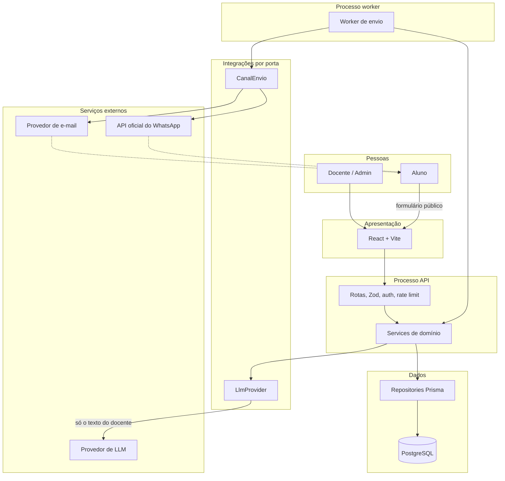
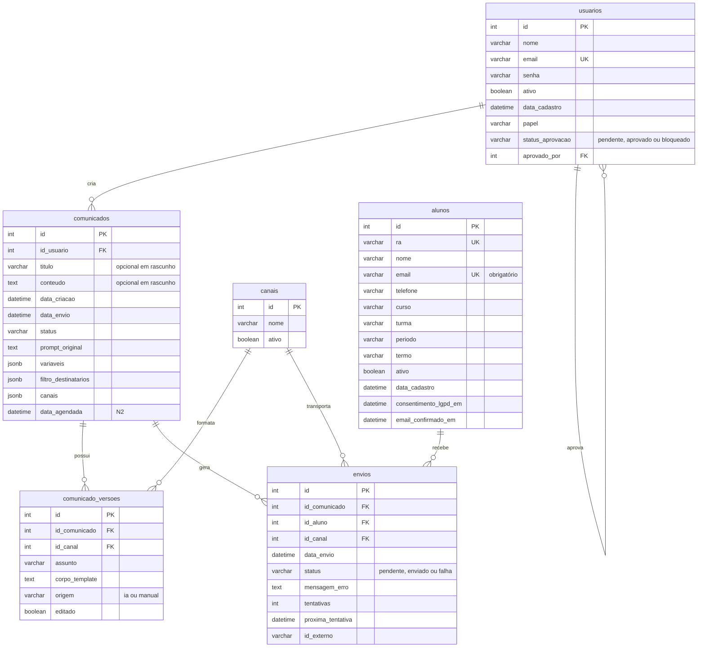
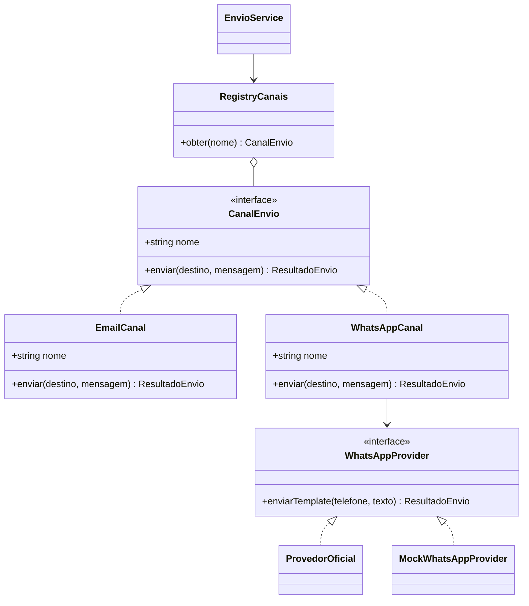
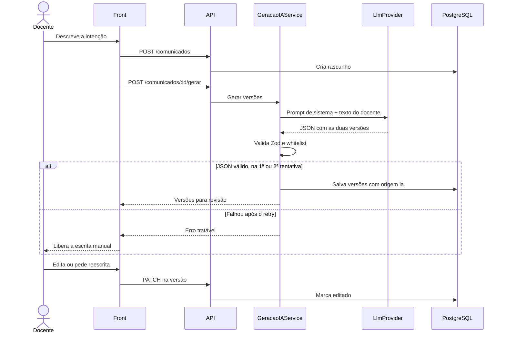
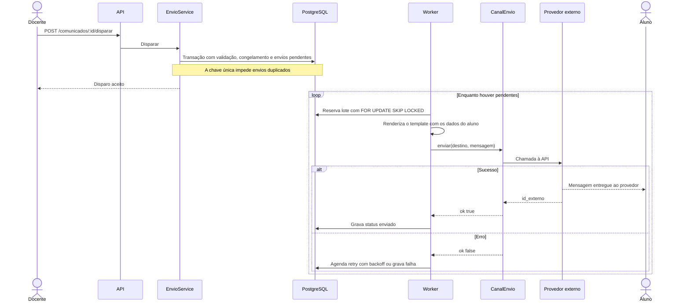

# Arquitetura do ACIF

> A stack e o padrão arquitetural estão **assumidos**, não aprovados. Valem como proposta até o orientador decidir o [ADR 0001](adr/0001-padrao-arquitetural-e-stack.md).

## 1. Visão geral

O ACIF centraliza o envio de comunicados da Fatec Garça. O docente ou admin cadastra o comunicado, seleciona os destinatários e o sistema envia por e-mail e WhatsApp. A IA gera as duas versões do texto, mas o sistema continua funcionando sem ela.

**Padrão:** monolito modular em camadas, `rota → service → repository`. Há um único código com dois processos: **API** e **worker de envio**. Portas e adapters existem só onde há variação real: `CanalEnvio` e `LlmProvider`.

Fora de cogitação no N1: microserviços, CQRS, DDD tático, Kubernetes e Redis.

## 2. Stack proposta

| Camada | Escolha |
|---|---|
| Backend | Node + TypeScript + Fastify + Zod (versão do Node no ADR 0001) |
| Banco | PostgreSQL + Prisma (migrations) |
| Frontend | React + Vite + Tailwind + TanStack Query; cliente tipado gerado do `openapi.yaml`; mocks com MSW |
| Fila | A própria tabela `envios`, com worker usando `SELECT … FOR UPDATE SKIP LOCKED`, concorrência limitada e retry com backoff |
| E-mail | Nodemailer + provedor transacional (Brevo, Resend ou SendGrid) |
| WhatsApp | `WhatsAppProvider`: Meta Cloud API, Twilio ou Mock (o Mock é obrigatório para CI e demo) |
| LLM | `LlmProvider` com saída JSON validada por Zod |
| Auth | JWT em cookie httpOnly + argon2/bcrypt |
| Testes e CI | Vitest + Supertest, 1 E2E com Playwright, GitHub Actions |
| Hospedagem | Render, Railway ou Fly + Postgres gerenciado (Neon ou Supabase) |

## 3. Camadas e componentes

- **Apresentação:** React, com as telas fiéis ao protótipo em [design/telas/](design/telas/).
- **API:** rotas, validação Zod, middleware de auth e rate limit.
- **Domínio:** `AuthService`, `AlunoService`, `ComunicadoService`, `DestinatarioService`, `GeracaoIAService`, `EnvioService`.
- **Dados:** repositories Prisma. **Rota nunca acessa Prisma direto.**
- **Integrações:** `CanalEnvio` (Email, WhatsApp) e `LlmProvider`.



## 4. Modelo de dados

O ponto de partida é [`diagrama_classe.png`](design/diagramas/diagrama_classe.png). Apesar do nome, ele é o ER original. O modelo abaixo acrescenta os ajustes aprovados.



**Restrições**

- `alunos`: chave única em `ra` e em `email`.
- `comunicado_versoes`: chave única em (`id_comunicado`, `id_canal`).
- `envios`: chave única em (`id_comunicado`, `id_aluno`, `id_canal`), que garante a idempotência do disparo.
- Status de `comunicados`: `rascunho`, `pronto`, `enviando`, `concluido`, `agendado` (N2).

**Decisões de modelagem em relação aos originais**

| Original | Neste modelo | Motivo |
|---|---|---|
| PK `id_usuario`, `id_comunicado` etc. | PK `id`, FK `id_<tabela>` | Convenção definida no bootstrap |
| `alunos.email` opcional | Obrigatório e único | O cadastro exige confirmação por e-mail (T08) |
| `titulo` e `conteudo` obrigatórios | Opcionais em `rascunho` e exigidos no disparo | A tela 03 não os coleta. `titulo` vem do assunto do e-mail ou, sem e-mail, do início do prompt |
| Sem canais no comunicado | `comunicados.canais` (jsonb) | O rascunho guarda os canais escolhidos antes de existir qualquer versão (T12) |
| Classe `Destinatario` (entidade do `mvp tcc.odt`) | Tabela `envios` | Cada linha é um destinatário em um canal |

**Destinatários:** o filtro aceita curso, período, turma, termo ou aluno individual. Filtro vazio significa todos os alunos ativos, opção que aparece no fluxograma e no painel. A tela sempre mostra a prévia de contagem antes do disparo.

**Base acadêmica:** a "consulta à base acadêmica" do fluxograma e a "integração com banco acadêmico" do `mvp tcc.odt` significam a tabela `alunos` local. Não existe integração com sistemas da Fatec.

## 5. Portas

### CanalEnvio (Strategy)

```ts
interface CanalEnvio {
  readonly nome: string; // = canais.nome
  enviar(d: DestinoAluno, m: MensagemRenderizada): Promise<ResultadoEnvio>;
}
// registry: { email: new EmailCanal(cfg), whatsapp: new WhatsAppCanal(provider) }
```

Um canal novo exige 1 classe, 1 linha no registry e 1 versão de tom.



`ProvedorOficial` é a Meta Cloud API ou a Twilio, conforme o [ADR 0002](adr/0002-provedor-whatsapp.md).

### LlmProvider

Recebe **somente** o texto do docente e o prompt de sistema versionado em `/prompts`. Devolve um JSON validado por Zod. O provedor será definido no [ADR 0004](adr/0004-provedor-llm.md).

## 6. Fluxo da IA

1. `POST /comunicados` cria o rascunho.
2. `POST /comunicados/:id/gerar` aciona o `GeracaoIAService`. As regras do prompt são: PT-BR institucional; não inventar datas ou links; preservar literalmente os placeholders da whitelist.
3. Uma única chamada ao LLM devolve `{ whatsapp:{corpo}, email:{assunto,corpo}, variaveis:{prazo} }`.
4. O Zod valida o JSON e a whitelist. Se falhar, há 1 retry. Se falhar de novo, a API devolve um erro tratável e o front libera a escrita manual.
5. As versões são salvas em `comunicado_versoes` com `origem=ia`. Editar faz `PATCH` na versão (`editado=true`). "Reescrever" repete a geração.

**Whitelist de placeholders:** `{nome_aluno}`, `{curso}`, `{prazo}`, `{termo}`. O `{email_aluno}` da tela de revisão só ilustra o campo "Para" e não é um placeholder.



## 7. Disparo e worker

`POST /comunicados/:id/disparar` faz, numa transação:

1. valida que toda variável tem valor para todos os alunos;
2. congela as versões;
3. resolve o filtro em alunos;
4. cria os envios pendentes.

O worker renderiza localmente com `render(template, {aluno, comunicado})`, chama `CanalEnvio.enviar()` e grava o status.

**Reserva do envio:** o `SKIP LOCKED` fica numa transação curta, que incrementa `tentativas` e adia `proxima_tentativa`. O envio externo acontece fora dessa transação, para não prender a conexão durante a chamada ao provedor. Se o worker cair, o envio volta a ficar disponível quando esse prazo vencer. A consequência é entrega *at-least-once*: uma queda entre o envio e a gravação do status pode repetir uma mensagem.



## 8. LGPD (inegociável)

- O LLM recebe **somente** o texto do docente. Nenhum dado de aluno sai do backend para ele.
- Logs não contêm PII.
- Sem consentimento, o aluno não é cadastrado.
- O aluno pode ser desativado.

Exigências de retenção e descadastro estão pendentes no [ADR 0009](adr/0009-lgpd.md).

## 9. WhatsApp oficial

Mensagem iniciada fora da janela de 24h exige template pré-aprovado. O texto da IA entra numa variável do template (ex.: "Comunicado da Fatec Garça: {{1}}"). **Não usar provedores não oficiais.**

## 10. Protótipo x escopo

Os protótipos orientam o visual, mas não ampliam o escopo.

| Elemento do protótipo | Tratamento |
|---|---|
| "Taxa de Leitura 98%", "98.6% de confirmações", "Taxa de Abertura ~98%" | Não reproduzir. Taxa de leitura é N3 e a demo nunca mostra número fictício |
| "GPT-4o Fatec" | Não vira fato; depende do ADR 0004 |
| Remetente `@fatec.sp.gov.br` | Não vira fato; depende do ADR 0006 |
| Ajustar tom, Refinar Vocabulário, Visão do Aluno, recibo por e-mail, recuperação de senha | Fora do backlog; só entram por ADR |
| Cancelar (fluxograma) | Sai da tela sem disparar e mantém o rascunho |

## 11. Origem dos artefatos

- [Caso de uso](design/diagramas/caso_de_uso.png), [ER original](design/diagramas/diagrama_classe.png) e [fluxograma](design/diagramas/fluxograma.jpeg): registro da modelagem inicial. Não incluem IA, aprovação de docente nem cadastro público de aluno, que entraram no escopo depois.
- [Telas](design/telas/) e [design system](design/telas/Image9.markdown): referência visual.
- `mvp tcc.odt`: definição inicial do MVP. Onde divergir deste documento, vale este documento (por exemplo, filtros e status passaram de N2 para N1).
