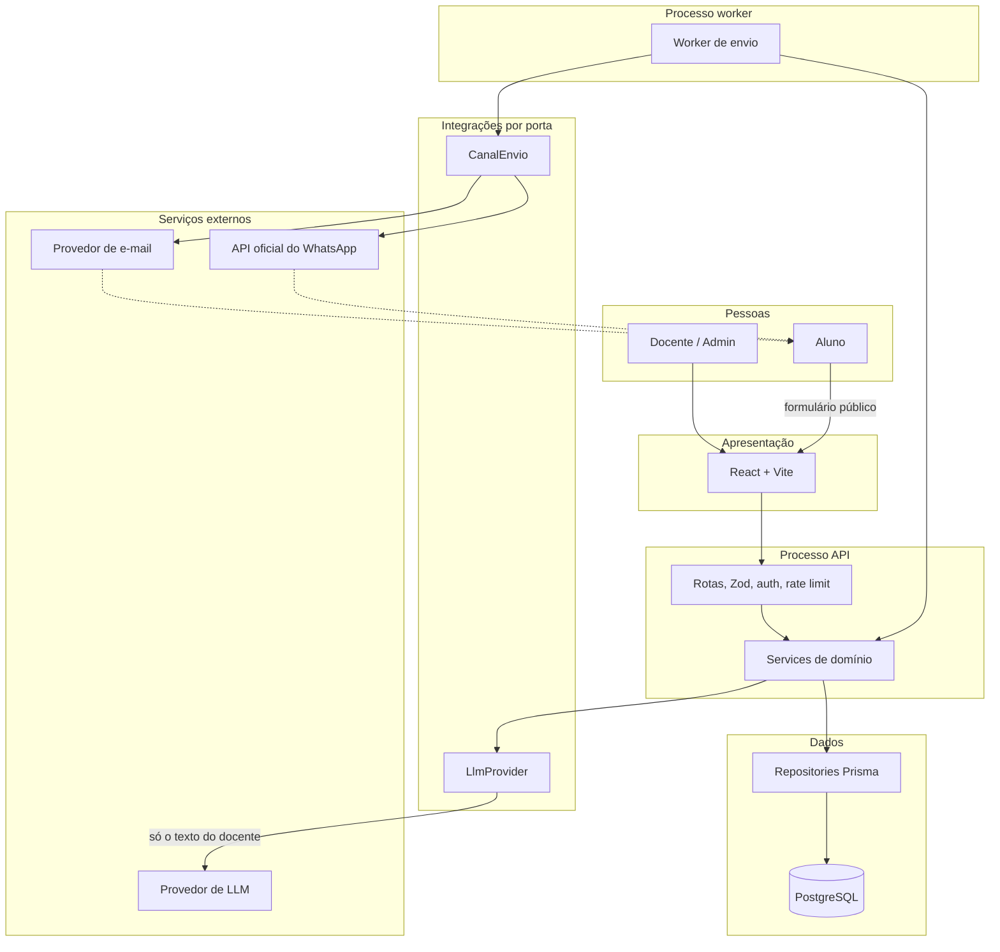
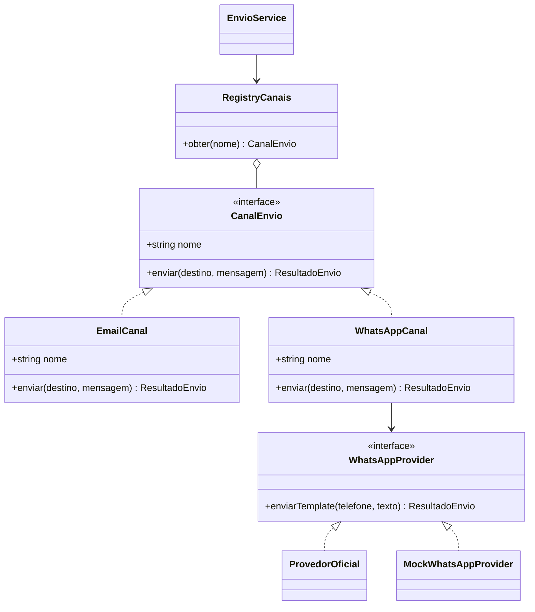
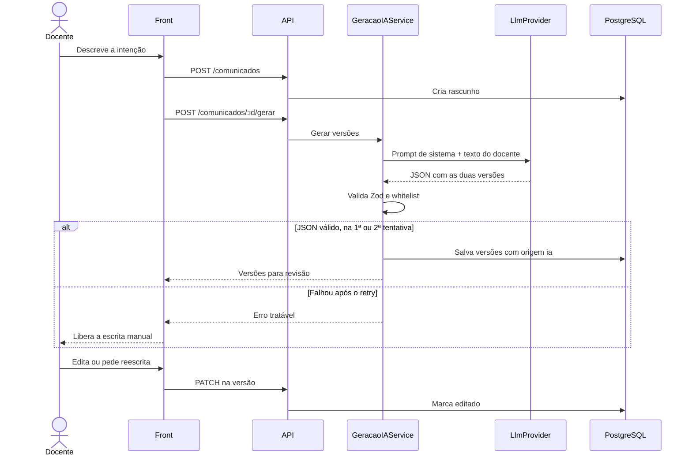
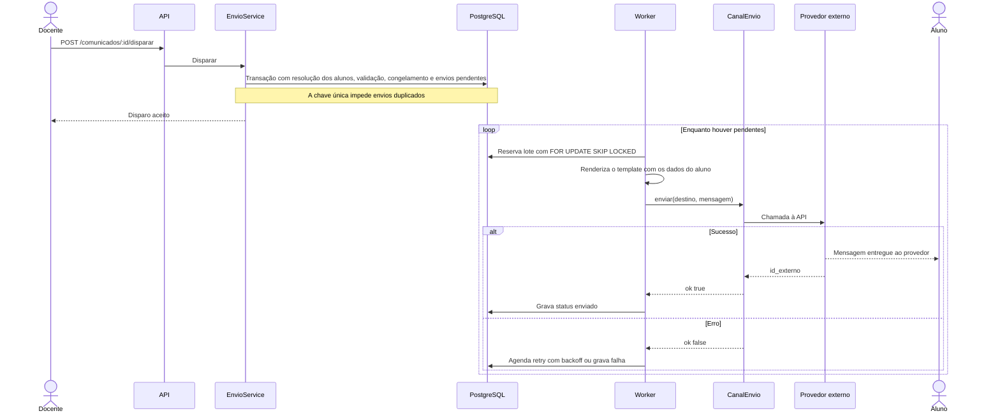

# Arquitetura do ACIF

> O padrão arquitetural e a stack foram aprovados no [ADR 0001](adr/0001-padrao-arquitetural-e-stack.md).

## 1. Visão geral

O ACIF centraliza o envio de comunicados da Fatec Garça. O docente ou admin cadastra o comunicado, seleciona os destinatários e o sistema envia por e-mail e WhatsApp. A IA gera as duas versões do texto, mas o sistema continua funcionando sem ela.

**Padrão:** monolito modular em camadas, `rota → service → repository`. Há um único código com dois processos: **API** e **worker de envio**. Portas e adapters existem só onde há variação real: `CanalEnvio` e `LlmProvider`.

Fora de cogitação no N1: microserviços, CQRS, DDD tático, Kubernetes e Redis.

## 2. Stack

| Camada | Escolha |
|---|---|
| Backend | Node LTS + TypeScript + Fastify + Zod |
| Banco | PostgreSQL + Prisma (migrations) |
| Frontend | React + Vite + Tailwind + TanStack Query; cliente tipado gerado do `openapi.yaml`; mocks com MSW |
| Fila | A própria tabela `envios`, com worker usando `SELECT … FOR UPDATE SKIP LOCKED`, concorrência limitada e retry com backoff |
| E-mail | Nodemailer + provedor transacional (Brevo, Resend ou SendGrid) |
| WhatsApp | `WhatsAppProvider`: Meta Cloud API com número de teste ou Mock (o Mock é obrigatório para CI e demo) |
| LLM | `LlmProvider` com saída JSON validada por Zod; Groq + Gemini em round robin |
| Auth | JWT em cookie httpOnly + argon2/bcrypt |
| Testes e CI | Vitest + Supertest, 1 E2E com Playwright, GitHub Actions |
| Hospedagem | Tudo local, em container na máquina do aluno, até a apresentação ([ADR 0005](adr/0005-hospedagem.md)) |

## 3. Camadas e componentes

- **Apresentação:** React, com as telas fiéis ao protótipo em [design/telas/](design/telas/).
- **API:** rotas, validação Zod, middleware de auth e rate limit.
- **Domínio:** `AuthService`, `AlunoService`, `ComunicadoService`, `DestinatarioService`, `GeracaoIAService`, `EnvioService`.
- **Dados:** repositories Prisma. **Rota nunca acessa Prisma direto.**
- **Integrações:** `CanalEnvio` (Email, WhatsApp) e `LlmProvider`.



### Estrutura do repositório e ambiente (T01)

```
backend/    API (src/server.ts) e worker (src/worker.ts): um código, dois processos
frontend/   React + Vite + Tailwind
prompts/    prompts de sistema versionados do LlmProvider
docs/       documentação, ADRs e TCC
docker/     Dockerfile.dev (imagem única de desenvolvimento)
```

- **npm workspaces** na raiz (`backend`, `frontend`): um lockfile, um `npm ci` e um lint compartilhado. Sem nx ou turborepo.
- **Versões:** Node 26 (LTS ativa em 10/11/2026, fixada em `.nvmrc`) e PostgreSQL 18. As dependências ficam fixadas no `package-lock.json`.
- **`docker-compose.yml`:** quatro serviços de longa duração e o `migrate` (T03), que roda uma vez. As portas são publicadas só em 127.0.0.1. O compose sobe sem `.env`, porque os padrões são só de desenvolvimento.

  | Serviço | Porta | Healthcheck |
  |---|---|---|
  | `db` | 5432 | `pg_isready` |
  | `api` | 3333 | `GET /health` |
  | `worker` | sem porta | sem healthcheck; `restart: unless-stopped` |
  | `web` | 5173 | `GET /` |
  | `migrate` (T03) | sem porta | roda uma vez: `prisma generate`, `migrate deploy` e seed (`SEED_AUTO=false` pula o seed); `api` e `worker` esperam ele terminar com sucesso |

- **CI** (`.github/workflows/ci.yml`), sem segredos e com dois jobs:
  - `checks`: lint, typecheck, testes e build, com um serviço PostgreSQL só para os testes de integração (banco `acif_test`, desde a T03).
  - `compose`: sobe o compose e confere o `/health`, a página e o heartbeat do worker; desde a T03, também o `migrate` e as contagens do seed; desde a T06, o login do admin do seed, o `/auth/me` com e sem cookie e o 401 de senha errada; desde a T07, o fluxo do docente: cadastro, 401 enquanto pendente, aprovação pelo admin, login, 403 nas rotas de admin e queda da sessão ao ser bloqueado.
- As imagens de produção, o backup e a retomada do worker ficam para a T34.

### Auth (T06)

Camadas: `rotas/auth.ts` (Zod) → `AuthService` → `UsuarioRepository` (Prisma). O hook reutilizável `app.autenticar` (em `plugins/autenticacao.ts`) protege as rotas e preenche `request.usuario = { id, nome, email, papel }`. Registro para a T04 documentar no `openapi.yaml`:

| Método e caminho | Entrada | Saída | Códigos |
|---|---|---|---|
| `POST /auth/login` | JSON `{ email, senha }`; e-mail com trim e minúsculas, até 254 caracteres; senha de 1 a 128 caracteres. Nada na query. | `200 { id, nome, papel }` e o cookie de sessão | 200, 400, 401, 429 |
| `POST /auth/logout` | nada | limpa o cookie; idempotente | 204 |
| `GET /auth/me` (protegida) | cookie de sessão | `200 { id, nome, email, papel }` | 200, 401 |

- **401 genérico**, igual para login inválido e sessão ausente ou inválida: `{ "erro": "nao_autenticado", "mensagem": "Credenciais inválidas ou sessão expirada." }`. E-mail inexistente, senha errada, docente pendente ou bloqueado e usuário inativo dão a mesma resposta. Todo login roda exatamente um `argon2.verify`: quando o e-mail não existe, contra um hash isca, para o tempo de resposta não revelar se a conta existe.
- **400:** `{ "erro": "requisicao_invalida", "mensagem": "Requisição inválida." }`, sem detalhar o campo. **429:** `{ "erro": "muitas_tentativas", ... }`, com 10 tentativas de login por minuto por IP (`@fastify/rate-limit`, store em memória).
- **Cookie** `acif_sessao`: `HttpOnly`, `SameSite=Strict`, `Path=/`, `Max-Age` de 8h e `Secure` só quando `COOKIE_SECURE=true` (no local é http). O token só é aceito no cookie, não no cabeçalho `Authorization`.
- **JWT:** HS256, com o algoritmo fixo na verificação. Leva só `sub` (id) e `papel`, sem e-mail nem nome. Sem refresh token: a sessão dura 8h. O segredo vem de `JWT_SECRET`, obrigatório em produção (no mínimo 32 caracteres); fora de produção há um padrão de desenvolvimento, e a API avisa no log.
- **Checagem no banco a cada requisição:** `app.autenticar` confere se o usuário segue `ativo` e `aprovado`. Bloquear ou inativar alguém (T07) derruba a sessão na hora. O logout só limpa o cookie, porque o JWT não tem estado.
- **Front x API (decisão para a T10):** o front usa o **proxy do Vite** (`/api` → `api:3333`), ficando na mesma origem da API. **Sem CORS** e sem `@fastify/cors`. CSRF fica coberto pelo `SameSite=Strict` e pelo corpo JSON nas rotas que mudam estado.
- **Logs sem PII:** a URL é logada sem a query string, e corpo, headers e cookies não são logados. O handler de erro não ecoa mensagens de validação nem do banco.
- **E-mail em minúsculas:** o login normaliza o e-mail antes da busca. Quem grava usuários (T07) precisa gravar o e-mail também em minúsculas.
- Variáveis: `JWT_SECRET`, `SESSAO_HORAS` (8), `COOKIE_SECURE` (`true` em produção), `LOGIN_RATE_LIMIT_MAX` (10) e, desde a T07, `CADASTRO_RATE_LIMIT_MAX` (5 por hora). Veja o `.env.example`.

### Docentes (T07)

Camadas: `rotas/docentes.ts` (Zod) → `DocenteService` → `UsuarioRepository` (Prisma). Conforme o [ADR 0008](adr/0008-aprovacao-docentes.md), quem aprova é o admin (a coordenação; a diretoria administra a coordenação), sem novos papéis. Não houve mudança de contrato: o fluxo usa `usuarios.papel`, `status_aprovacao`, `aprovado_por` e `data_cadastro`, já existentes. Registro para a T04 documentar no `openapi.yaml`:

| Método e caminho | Quem chama | Entrada | Saída | Códigos |
|---|---|---|---|---|
| `POST /docentes/cadastro` | público, com rate limit | JSON estrito `{ nome, email, senha }`. `nome` com trim, de 2 a 120 caracteres; `email` com trim e minúsculas, até 254; `senha` de 12 a 128 caracteres, sem regras de composição. Qualquer outra chave (ex.: `papel`, `status_aprovacao`) dá 400 | `202 { mensagem }`, igual para conta nova e e-mail já cadastrado | 202, 400, 429 |
| `GET /docentes` | só admin | query `status?` (`pendente`, `aprovado` ou `bloqueado`), `pagina` e `por_pagina` como na T12 | `200 { itens, pagina, por_pagina, total }`; cada item tem `id, nome, email, status_aprovacao, data_cadastro`. Só `papel = 'docente'`, sem senha. Ordem: `data_cadastro` desc, `id` desc | 200, 400, 401, 403 |
| `POST /docentes/:id/aprovar` | só admin | `id` inteiro de 1 a 2147483647 | `200` com o docente (mesmo formato do item). Também reativa um bloqueado | 200, 400, 401, 403, 404, 409 |
| `POST /docentes/:id/bloquear` | só admin | idem | idem | 200, 400, 401, 403, 404, 409 |

- **Conta nova:** sempre `papel = 'docente'`, `status_aprovacao = 'pendente'`, `ativo = true`, e-mail em minúsculas e senha com hash argon2id. Pendente não loga: o login da T06 dá o 401 genérico.
- **E-mail duplicado não é revelado:** o cadastro responde o mesmo `202` com a mesma mensagem, inclusive para o e-mail de um admin, e não altera a conta existente. O hash argon2id roda sempre, antes de gravar, e o service sempre tenta o `create`, para aproximar o tempo de resposta dos dois casos. A diferença não some: na revisão (12/11/2026, 8 pares de pedidos), o duplicado respondeu cerca de 10 ms mais rápido que o novo (≈66 ms contra ≈77 ms), provavelmente porque o INSERT falha antes do commit. Com o rate limit de 5 cadastros por hora por IP, usar essa diferença para enumerar contas é inviável na prática. A unicidade é garantida pelo banco: a violação (`P2002`) vira `duplicado` dentro do repository, o que também resolve dois cadastros simultâneos. Custo aceito: quem esqueceu que já se cadastrou não fica sabendo pela API e procura a coordenação, como a tela 01 já orienta.
- **Rate limit do cadastro:** `CADASTRO_RATE_LIMIT_MAX` por hora, por IP (padrão 5), com o mesmo `@fastify/rate-limit` em memória do login. Requisições inválidas (400) também consomem a cota: no E2E da revisão, os 400 contaram e o 6º pedido recebeu 429. Atrás do proxy do Vite, em que todos chegam com o mesmo IP, isso agrava o risco R15: poucos formulários mal preenchidos esgotam o cadastro de todos por até 1 hora.
- **Passo E2E do CI ("Docentes de ponta a ponta (T07)"):** usa um e-mail fixo (`t07.e2e@example.com`) e espera que o docente nasça pendente, então só passa num banco novo. Para rodá-lo localmente, recrie o banco antes (`docker compose down -v`).
- **Transições:** `pendente → aprovado`, `pendente → bloqueado` (rejeição), `aprovado → bloqueado` e `bloqueado → aprovado` (reativação). Não há volta para `pendente`. Cada decisão é um único `updateMany` condicionado a `{ id, papel: 'docente', status_aprovacao IN origens }`, atômico. Pedir o status em que o docente já está responde `200` sem nova escrita (idempotente, para o clique duplo na T10). Se outro admin mudar o status entre o UPDATE e a releitura, a resposta é `409 { "erro": "conflito" }`.
- **`aprovado_por`:** guarda o **admin da última decisão**, seja aprovação ou bloqueio (decisão do aluno, 12/11/2026). Num docente bloqueado, aponta quem bloqueou. Repetir a decisão não reescreve o campo.
- **O admin não bloqueia a si mesmo nem outro admin:** as decisões só alcançam `papel = 'docente'`. O id de um admin dá o mesmo `404 { "erro": "nao_encontrado" }` de um id inexistente. Assim, nunca se perde o último admin pela API. O campo `ativo` não é alterado pela T07.
- **Só admin:** o preHandler `app.exigirAdmin` (em `plugins/autenticacao.ts`), usado depois do `app.autenticar`, responde `403 { "erro": "acesso_negado", "mensagem": "Acesso restrito ao administrador." }`. O papel vem do banco a cada requisição, não do JWT: um token com `papel: admin` forjado ou desatualizado não passa.
- **Sessão do bloqueado:** pela checagem no banco da T06, o docente bloqueado recebe 401 já na próxima requisição, mesmo com o cookie ainda válido.
- **Logs sem PII:** nome, e-mail e senha não são logados. Cada decisão que altera o status gera um log só com ids: `{ evento: 'docente_aprovado' | 'docente_bloqueado', id_docente, id_admin }`.
- **LGPD:** nome e e-mail de docente são dados pessoais. Só o admin os vê. Testes, E2E e demo usam só `@example.com`. Não há exclusão de docente nesta entrega (risco R17).

### Comunicados (T12)

Camadas: `rotas/comunicados.ts` (Zod) → `ComunicadoService` → `ComunicadoRepository` e `CanalRepository` (Prisma). Todas as rotas exigem sessão (`app.autenticar`), e o dono é sempre `request.usuario.id`, nunca o corpo. Os formatos dos jsonb ficam em `backend/src/dominio/comunicado.ts`, para a T13, a T14 e a T16 reaproveitarem. Registro para a T04 documentar no `openapi.yaml`:

| Método e caminho | Entrada | Saída | Códigos |
|---|---|---|---|
| `POST /comunicados` | JSON com `titulo?`, `conteudo?`, `prompt_original?`, `canais?`, `filtro_destinatarios?`, `variaveis?`. Corpo vazio cria um rascunho vazio | `201` com o comunicado completo | 201, 400, 401, 422 |
| `GET /comunicados` | query `pagina` (1 a 100.000, padrão 1) e `por_pagina` (1 a 50, padrão 20) | `200 { itens, pagina, por_pagina, total }`; cada item tem `id, titulo, status, canais, data_criacao, data_envio`. Ordem: `data_criacao` desc, `id` desc. Página além do total devolve `itens: []` com o `total` real | 200, 400, 401 |
| `GET /comunicados/:id` | `id` inteiro de 1 a 2147483647 | `200` com o comunicado completo | 200, 400, 401, 404 |
| `PATCH /comunicados/:id` | os mesmos campos do POST, parciais; `null` limpa o campo (exceto `canais`, que se limpa com `[]`) | `200` com o comunicado completo | 200, 400, 401, 404, 409, 422 |
| `DELETE /comunicados/:id` | nada | `204`; apaga também as `comunicado_versoes` | 204, 400, 401, 404, 409 |

- **Comunicado completo:** `id, titulo, conteudo, prompt_original, status, canais, filtro_destinatarios, variaveis, data_criacao, data_envio`. Sem `id_usuario` e sem `data_agendada` (N2).
- **Textos:** `titulo` até 200 caracteres, `conteudo` até 10.000 e `prompt_original` até 600 (limite da tela 03). Os textos passam por trim, e string vazia vira `null`. `titulo` e `conteudo` são opcionais no rascunho e exigidos no disparo (T16). `prompt_original` é o texto do docente que o `/gerar` (T22) envia ao LLM; a T12 só o armazena.
- **`canais`:** lista de `canais.nome` (`email`, `whatsapp`), sem repetição. Vazia no rascunho é aceita. Nome desconhecido dá 400; canal ausente da tabela `canais` ou inativo dá 422.
- **`filtro_destinatarios`:** uma de duas formas, com objetos estritos (misturar as duas dá 400):
  - por turma: `{ curso?, periodo?, turma?, termo? }`, cada um uma lista de até 50 textos (até 120 caracteres em `curso` e até 20 nos demais). Os campos se combinam com E e os valores de um campo com OU;
  - aluno individual: `{ ids_alunos: [1, 2] }`, de 1 a 500 ids e só ids, sem outro dado do aluno. `ids_alunos: []` dá 400, para não virar "todos".
  - `null`, `{}` ou só listas vazias significam **todos os alunos ativos** e são gravados como SQL NULL. Repetições são removidas.
- **`variaveis`:** `{ prazo?: string }` (1 a 100 caracteres, texto livre). Qualquer outra chave dá 400. `nome_aluno`, `curso` e `termo` vêm do cadastro do aluno na renderização. `{}` é gravado como NULL. A validação dos placeholders dentro dos textos fica para a T14; a whitelist está em `PLACEHOLDERS` (`backend/src/dominio/valores.ts`).
- **Isolamento:** toda consulta do repository filtra por `id_usuario`. Comunicado de outro usuário responde **404 idêntico** ao de id inexistente (não revela a existência), inclusive em PATCH e DELETE. O **admin também só vê os próprios comunicados**: o ADR 0008 dá ao admin apenas a aprovação de docentes, e múltiplos papéis são N3.
- **Só rascunho é editável:** PATCH e DELETE usam `updateMany`/`deleteMany` condicionados a `status IN STATUS_EDITAVEIS` (`['rascunho']`), de forma atômica. Fora de rascunho: `409 { "erro": "comunicado_nao_editavel" }`. A ordem das checagens é 404 → 409 → 422.
- **Erros:** `400 requisicao_invalida` genérico (sem detalhar o campo), `401 nao_autenticado` (T06), `404 { "erro": "nao_encontrado" }`, `409 { "erro": "comunicado_nao_editavel" }`, `422 { "erro": "canal_indisponivel" }`. Os jsonb são revalidados na leitura; dado corrompido vira 500 genérico.
- **Logs sem PII:** título, conteúdo, prompt e variáveis não são logados; só método e URL.
- **Para a T16:** exigir `titulo`, `conteudo` e ao menos um canal; checar de novo se os canais seguem ativos (o admin pode desativar um canal depois de gravado no rascunho); tirar o comunicado de `rascunho` com um `updateMany` condicionado a `status = 'rascunho'`. A partir daí, a T12 responde 409 sem mudança.
- **Pendência para a T13 (risco):** os valores de período divergem. O seed grava `Manhã`/`Noite`, e o protótipo (tela 03) mostra `Matutino`/`Vespertino`/`Noturno`. A T12 não valida os valores do filtro contra uma lista fixa; a T13 (e o cadastro da T09) precisam alinhar os valores, senão o filtro por período não casa com os alunos.

### Renderizador (T14)

Módulo puro em `backend/src/dominio/renderizador.ts`: sem Prisma, sem rede e sem log. Não há rota nova. O rascunho (T12) continua aceitando qualquer texto; o bloqueio acontece no disparo.

- **Sintaxe estrita:** um placeholder é exatamente `{nome}`, com `nome` em `PLACEHOLDERS` (`{nome_aluno}`, `{curso}`, `{prazo}`, `{termo}`), com diferença entre maiúsculas e minúsculas. `{x}`, `{ nome_aluno}`, `{NOME_ALUNO}` e `{}` são `placeholder_desconhecido`. `{{x}}`, chave aberta ou fechada solta e chaves aninhadas são `sintaxe_invalida`. Um placeholder pode se repetir.
- **Limitação: sem escape.** Não há como escrever uma chave literal no texto. Chave fora de um placeholder válido bloqueia o disparo.
- **Origem dos valores:** `nome_aluno` → `alunos.nome`, `curso` → `alunos.curso`, `termo` → `alunos.termo`, `prazo` → `comunicados.variaveis.prazo`. O mapa usa `satisfies Record<Placeholder, …>`: placeholder novo sem origem não compila. Os valores passam por trim, e vazio conta como ausente. O renderizador recebe só `{ nome, curso, termo }` do aluno.
- **API:**
  - `analisarTemplate(texto)`: `{ ok:true, placeholders }` ou `{ ok:false, erros }`. Serve também à T21/T22 para conferir as versões geradas.
  - `validarDisparo({ textos, variaveis, alunos })`: validação prévia. `textos` são o `assunto` e o `corpo` de cada versão, com o canal; `alunos` são os destinatários já resolvidos (T13). Bloqueia por placeholder desconhecido, sintaxe inválida, `{prazo}` usado sem valor, ou placeholder usado sem valor para algum aluno; neste caso, o disparo inteiro para, e o erro traz só a contagem de alunos afetados. Placeholder que o texto não usa não exige valor.
  - `renderizar(texto, { aluno, variaveis })`: substitui todas as ocorrências numa passada só (o valor inserido não é lido de novo). Não lança: template inválido ou valor ausente viram `ok:false`. Gera texto puro; escapar HTML é papel do `EmailCanal` (T15), se ele enviar HTML.
- **Erros sem dado de aluno:** `{ codigo: 'placeholder_desconhecido', placeholder, canal, campo }`, `{ codigo: 'sintaxe_invalida', canal, campo }` e `{ codigo: 'valor_ausente', placeholder, alunos? }`. Nunca trazem nome, id ou outro dado de aluno. Exceção quanto ao texto do docente: em `placeholder_desconhecido`, o campo `placeholder` repete até 40 caracteres (`MAX_NOME_NO_ERRO`) do que estava entre chaves, para o docente achar e corrigir o próprio texto. Não é dado de aluno, mas é texto livre: a T16 devolve esses erros na resposta e **não deve logá-los**.
- **Contrato que a T16 assume:** dentro da transação do disparo, resolver o filtro em alunos e só então chamar `validarDisparo` com esses alunos. Se der `ok:false`, responder **422 com a lista de erros**, sem criar envios e sem mudar o status do comunicado.
- **Pontos para a T16/T17:**
  - `variaveis` deve passar por `esquemaVariaveis` (Zod, em `backend/src/dominio/comunicado.ts`) antes de chegar ao renderizador, como o `ComunicadoService` já faz ao montar o detalhe. O renderizador confia no tipo: se `prazo` não for string, o trim lançaria `TypeError`.
  - `validarDisparo` com `alunos: []` devolve `ok:true`. O caso "0 destinatários" é responsabilidade da T16.
- **Para a T17:** o worker chama `renderizar` por envio. `ok:false` (por exemplo, o cadastro do aluno mudou depois do disparo) vira `falha` naquele envio, sem derrubar o lote.

## 4. Modelo de dados

O ponto de partida é [`diagrama_classe.png`](design/diagramas/diagrama_classe.png). Apesar do nome, ele é o ER original. O modelo abaixo acrescenta os ajustes aprovados.

```mermaid
erDiagram
    usuarios ||--o{ comunicados : cria
    usuarios ||--o{ usuarios : aprova
    comunicados ||--o{ comunicado_versoes : possui
    canais ||--o{ comunicado_versoes : formata
    comunicados ||--o{ envios : gera
    alunos ||--o{ envios : recebe
    canais ||--o{ envios : transporta

    usuarios {
        int id PK
        varchar nome
        varchar email UK
        varchar senha
        boolean ativo
        datetime data_cadastro
        varchar papel
        varchar status_aprovacao "pendente, aprovado ou bloqueado"
        int aprovado_por FK
    }
    alunos {
        int id PK
        varchar ra UK
        varchar nome
        varchar email UK "obrigatório"
        varchar telefone
        varchar curso
        varchar turma
        varchar periodo
        varchar termo
        boolean ativo
        datetime data_cadastro
        datetime consentimento_lgpd_em
        datetime email_confirmado_em
    }
    comunicados {
        int id PK
        int id_usuario FK
        varchar titulo "opcional em rascunho"
        text conteudo "opcional em rascunho"
        datetime data_criacao
        datetime data_envio
        varchar status
        text prompt_original
        jsonb variaveis
        jsonb filtro_destinatarios
        jsonb canais
        datetime data_agendada "N2"
    }
    comunicado_versoes {
        int id PK
        int id_comunicado FK
        int id_canal FK
        varchar assunto
        text corpo_template
        varchar origem "ia ou manual"
        boolean editado
    }
    canais {
        int id PK
        varchar nome UK "chave do registry de CanalEnvio"
        boolean ativo
    }
    envios {
        int id PK
        int id_comunicado FK
        int id_aluno FK
        int id_canal FK
        datetime data_envio
        varchar status "pendente, enviado ou falha"
        text mensagem_erro
        int tentativas
        datetime proxima_tentativa
        varchar id_externo
    }
```



**Restrições**

- `alunos`: chave única em `ra` e em `email`.
- `canais`: chave única em `nome`, que é a chave do registry de `CanalEnvio` e do upsert do seed.
- `comunicado_versoes`: chave única em (`id_comunicado`, `id_canal`).
- `envios`: chave única em (`id_comunicado`, `id_aluno`, `id_canal`), que garante a idempotência do disparo.
- Status de `comunicados`: `rascunho`, `pronto`, `enviando`, `concluido`, `agendado` (N2).

**Decisões de modelagem em relação aos originais**

| Original | Neste modelo | Motivo |
|---|---|---|
| PK `id_usuario`, `id_comunicado` etc. | PK `id`, FK `id_<tabela>` | Convenção definida no bootstrap |
| `alunos.email` opcional | Obrigatório e único | O cadastro exige confirmação por e-mail (T08) |
| `titulo` e `conteudo` obrigatórios | Opcionais em `rascunho` e exigidos no disparo | A tela 03 não os coleta. `titulo` vem do assunto do e-mail ou, sem e-mail, do início do prompt |
| Sem canais no comunicado | `comunicados.canais` (jsonb) | O rascunho guarda os canais escolhidos antes de existir qualquer versão (T12) |
| Classe `Destinatario` (entidade do `mvp tcc.odt`) | Tabela `envios` | Cada linha é um destinatário em um canal |
| `canais.nome` sem restrição | Chave única | O registry de `CanalEnvio` e o seed localizam o canal pelo nome; evita canal duplicado e protege a idempotência de `envios` (`/mudanca-contrato` aprovada em 10/11/2026, T03) |

**Preenchimentos do ER na implementação (T03, aprovados pelo aluno em 10/11/2026)**

O ER não define estes pontos. Eles foram fixados no `backend/prisma/schema.prisma` sem alterar nada do que está acima.

| Ponto | Decisão |
|---|---|
| Status e papel | `varchar`, sem enum nem `CHECK` no banco. Os valores aceitos ficam em constantes `as const` (`backend/src/dominio/valores.ts`) e são validados no código. `papel`: `admin` ou `docente`. |
| Datas | `timestamptz(3)` (`@db.Timestamptz(3)`); `data_cadastro` e `data_criacao` com padrão `now()` |
| `usuarios.aprovado_por` | Mantém o nome do ER (exceção ao padrão `id_<tabela>`); FK opcional para `usuarios.id` |
| `alunos` | Obrigatórios: `ra` (único), `nome`, `email` (único), `curso`, `periodo`, `termo` e `consentimento_lgpd_em`. Opcionais: `telefone`, `turma` e `email_confirmado_em` |
| jsonb de `comunicados` | `canais` obrigatório com padrão `[]`; `variaveis` e `filtro_destinatarios` opcionais |
| Opcionais e padrões | `ativo` com padrão `true`; `status_aprovacao` com padrão `pendente`; `comunicados.status` com padrão `rascunho`; `envios.status` com padrão `pendente`; `tentativas` com padrão `0`; `editado` com padrão `false`; `comunicado_versoes.assunto` opcional (o WhatsApp não tem assunto); `data_envio`, `proxima_tentativa`, `mensagem_erro`, `id_externo`, `prompt_original` e `data_agendada` opcionais |
| Tamanhos de varchar | `nome` 120; `email` 254; `senha` 255 (guarda o hash argon2id); `papel` e status 20; `ra`, `telefone`, `turma`, `periodo` e `termo` 20; `curso` 120; `titulo` e `assunto` 200; `origem` 10; `canais.nome` 30; `id_externo` 255 |
| Chaves estrangeiras | `ON DELETE RESTRICT` em todas. A exclusão de aluno com histórico de envios fica para a T35 |
| Nomes no Prisma | Model no singular com `@@map` para a tabela (`Usuario` → `usuarios`); campos em snake_case, iguais às colunas |
| Seed | Só dados sintéticos: alunos `Aluno Sintético NN`, e-mails `@example.com` (domínio reservado, RFC 2606), RA `SINTnnnn` e telefone nulo, porque não há faixa de telefone reservada (regra 7). Admin em `SEED_ADMIN_EMAIL` e `SEED_ADMIN_SENHA`, com padrão só de desenvolvimento |

**Destinatários:** o filtro aceita curso, período, turma, termo ou aluno individual. Filtro vazio significa todos os alunos ativos, opção que aparece no fluxograma e no painel. A tela sempre mostra a prévia de contagem antes do disparo.

**Base acadêmica:** a "consulta à base acadêmica" do fluxograma e a "integração com banco acadêmico" do `mvp tcc.odt` significam a tabela `alunos` local. Não existe integração com sistemas da Fatec.

## 5. Portas

### CanalEnvio (Strategy)

```ts
interface CanalEnvio {
  readonly nome: string; // = canais.nome
  enviar(d: DestinoAluno, m: MensagemRenderizada): Promise<ResultadoEnvio>;
}
// registry: { email: new EmailCanal(cfg), whatsapp: new WhatsAppCanal(provider) }
```

Um canal novo exige 1 classe, 1 linha no registry e 1 versão de tom.



`ProvedorOficial` é a Meta Cloud API, conforme o [ADR 0002](adr/0002-provedor-whatsapp.md).

**Configuração pelo admin:** telas administrativas permitem ajustar os dados de e-mail e WhatsApp, com segredos criptografados no banco e variáveis de ambiente como padrão (T42 e T43; ADRs 0002 e 0006). A estrutura de dados será definida por `/mudanca-contrato` na T42.

### LlmProvider

Recebe **somente** o texto do docente e o prompt de sistema versionado em `/prompts`. Devolve um JSON validado por Zod. Conforme o [ADR 0004](adr/0004-provedor-llm.md), Groq e Gemini, nos planos gratuitos, alternam em round robin. Se os dois falharem, vale o fallback manual.

## 6. Fluxo da IA

1. `POST /comunicados` cria o rascunho.
2. `POST /comunicados/:id/gerar` aciona o `GeracaoIAService`. As regras do prompt são: PT-BR institucional; não inventar datas ou links; preservar literalmente os placeholders da whitelist.
3. Uma única chamada ao LLM devolve `{ whatsapp:{corpo}, email:{assunto,corpo}, variaveis:{prazo} }`.
4. O Zod valida o JSON e a whitelist. Se falhar, há 1 retry. Se falhar de novo, a API devolve um erro tratável e o front libera a escrita manual.
5. As versões são salvas em `comunicado_versoes` com `origem=ia`. Editar faz `PATCH` na versão (`editado=true`). "Reescrever" repete a geração.

**Whitelist de placeholders:** `{nome_aluno}`, `{curso}`, `{prazo}`, `{termo}`. O `{email_aluno}` da tela de revisão só ilustra o campo "Para" e não é um placeholder.



## 7. Disparo e worker

`POST /comunicados/:id/disparar` faz, numa transação:

1. resolve o filtro em alunos;
2. valida que toda variável tem valor para todos esses alunos (`validarDisparo`, que recebe os alunos já resolvidos; ver "Renderizador (T14)");
3. congela as versões;
4. cria os envios pendentes.

O worker renderiza localmente com `renderizar(texto, { aluno, variaveis })`, chama `CanalEnvio.enviar()` e grava o status.

**Reserva do envio:** o `SKIP LOCKED` fica numa transação curta, que incrementa `tentativas` e adia `proxima_tentativa`. O envio externo acontece fora dessa transação, para não prender a conexão durante a chamada ao provedor. Se o worker cair, o envio volta a ficar disponível quando esse prazo vencer. A consequência é entrega *at-least-once*: uma queda entre o envio e a gravação do status pode repetir uma mensagem.



## 8. LGPD (inegociável)

- O LLM recebe **somente** o texto do docente. Nenhum dado de aluno sai do backend para ele.
- A tela de criação avisa que o prompt não deve conter dados pessoais, porque planos gratuitos podem usar o conteúdo enviado ([ADR 0004](adr/0004-provedor-llm.md)).
- Logs não contêm PII.
- Sem consentimento, o aluno não é cadastrado.
- O aluno pode ser desativado.

O enquadramento acadêmico aprovado está no [ADR 0009](adr/0009-lgpd.md): dados sintéticos no desenvolvimento e na demo, dado real só na sessão de teste controlada, termo de consentimento, minimização de campos, desativação e exclusão de aluno no admin e descarte dos dados de teste após a defesa.

> Este enquadramento vale para o protótipo acadêmico local. Caso a ferramenta seja adotada em produção, a LGPD deve ser debatida com a coordenação, a diretoria e o TI, todos juntos, antes de qualquer uso real.

## 9. WhatsApp oficial

Mensagem iniciada fora da janela de 24h exige template pré-aprovado. O texto da IA entra numa variável do template (ex.: "Comunicado da Fatec Garça: {{1}}"). **Não usar provedores não oficiais.**

## 10. Protótipo x escopo

Os protótipos orientam o visual, mas não ampliam o escopo.

| Elemento do protótipo | Tratamento |
|---|---|
| "Taxa de Leitura 98%", "98.6% de confirmações", "Taxa de Abertura ~98%" | Não reproduzir. Taxa de leitura é N3 e a demo nunca mostra número fictício |
| "GPT-4o Fatec" | Não reproduzir; os provedores são os do ADR 0004 |
| Remetente `@fatec.sp.gov.br` | Mostrar o remetente real configurado pelo admin (ADR 0006) |
| Ajustar tom, Refinar Vocabulário, Visão do Aluno, recuperação de senha | Fora do backlog; só entram por ADR |
| Recibo por e-mail ("cópia para o docente") | N3, segundo `RESPOSTA 1.odt`; fora desta entrega |
| Cancelar (fluxograma) | Sai da tela sem disparar e mantém o rascunho |

## 11. Origem dos artefatos

- [Caso de uso](design/diagramas/caso_de_uso.png), [ER original](design/diagramas/diagrama_classe.png) e [fluxograma](design/diagramas/fluxograma.jpeg): registro da modelagem inicial. Não incluem IA, aprovação de docente nem cadastro público de aluno, que entraram no escopo depois.
- [Telas](design/telas/) e [design system](design/telas/Image9.markdown): referência visual.
- `mvp tcc.odt`: definição inicial do MVP. Onde divergir deste documento, vale este documento (por exemplo, filtros e status passaram de N2 para N1).
