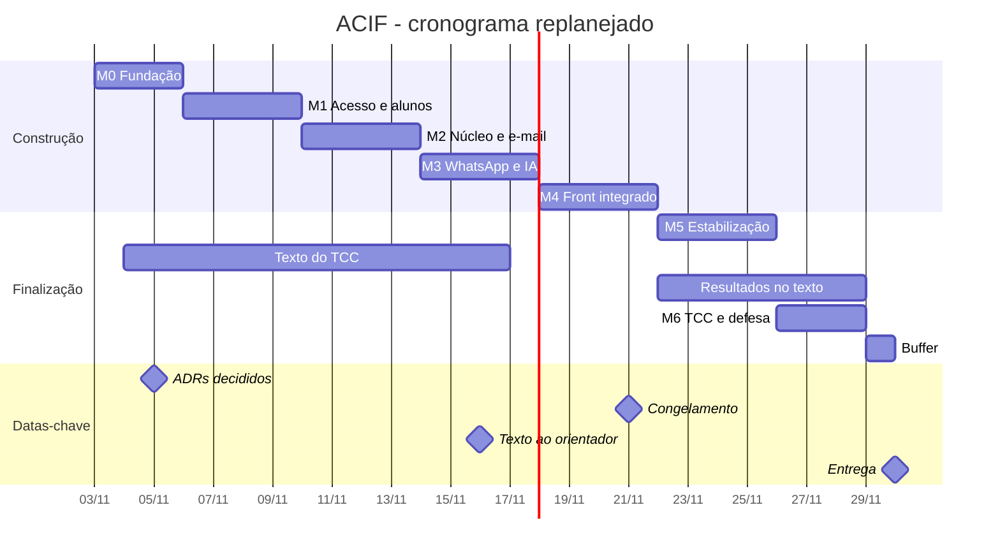

# Roadmap do ACIF

**Entrega final:** 30/11/2026. **Congelamento de features:** 21/11/2026.

> Cronograma replanejado em 03/11/2026. As tasks começaram em 03/11, depois do início previsto em 13/10, e o tempo restante foi redistribuído. Em 04/11/2026, o orientador pediu o texto do TCC para correção o quanto antes, no máximo até 25/11/2026. Em 10/11/2026, o aluno antecipou a entrega para 16/11/2026.

## Marcos

| Marco | Período | Pronto quando | Capítulo do TCC |
|---|---|---|---|
| M0 Fundação | 03/11–05/11/2026 | `docker compose up` sobe API + DB; a migration roda do zero; ADRs 0001–0009 decididos e registrados | Introdução, problema, objetivo |
| M1 Acesso e alunos | 06/11–09/11/2026 | Docente se cadastra, é aprovado e loga; aluno se cadastra pelo link, confirma o e-mail e aparece na base | Metodologia ADD e requisitos |
| M2 Núcleo + e-mail | 10/11–13/11/2026 | Via API, um comunicado chega por e-mail real a alunos de teste e o status fica gravado | Modelagem e arquitetura |
| M3 WhatsApp + IA | 14/11–17/11/2026 | Comunicado gerado pela IA é enviado pelos 2 canais a números de teste; script E2E via API; texto do TCC entregue ao orientador até 16/11/2026 | Integrações e IA |
| M4 Front integrado | 18/11–21/11/2026 | Login → criar → gerar → revisar → disparar → status funciona na UI com dados reais | Telas e resultados parciais |
| M5 Estabilização | 22/11–25/11/2026 | Sistema completo sobe localmente em containers; relatório de testes; docs refletem o código; tag v1.0; capítulos de testes e resultados completos | Testes e resultados |
| M6 TCC + defesa | 26/11–28/11/2026 | Correções do orientador incorporadas; 2 ensaios feitos | Conclusão |
| Buffer | 29/11/2026 | Contingência | — |
| Entrega | 30/11/2026 | TCC submetido | — |

O texto do TCC (T39) é escrito em paralelo às demais tasks e faz parte do M3, com entrega ao orientador até 16/11/2026, antes do limite de 25/11/2026 pedido por ele. Os resultados que ainda não existirem nessa data vão marcados com `[VERIFICAR]`; os capítulos de testes e resultados são completados depois da sessão de teste (T36), e as correções do orientador entram até a submissão.

## Gráfico

## Regras

- **Corte:** se um marco atrasar mais de 2 dias, corte primeiro as N2 do marco seguinte. N3 nunca entra.
- **Fora do backlog:** só entra por ADR.
- **IA:** sempre com fallback manual. O sistema funciona sem o LLM.

## Cronograma original (histórico)

Registrado para mostrar à banca o que mudou. Não está mais em vigor.

| Marco | Período original |
|---|---|
| M0 Fundação | 13/10–18/10/2026 |
| M1 Acesso e alunos | 19/10–25/10/2026 |
| M2 Núcleo + e-mail | 26/10–01/11/2026 |
| M3 WhatsApp + IA | 02/11–08/11/2026 |
| M4 Front integrado | 09/11–15/11/2026 (congelamento em 15/11) |
| M5 Estabilização | 16/11–22/11/2026 |
| M6 TCC + defesa | 23/11–27/11/2026 |
| Buffer | 28/11–29/11/2026 |

Os prazos originais dos ADRs eram 18/10/2026 (0001–0007) e 25/10/2026 (0008–0009). Agora todos vencem em 05/11/2026.
